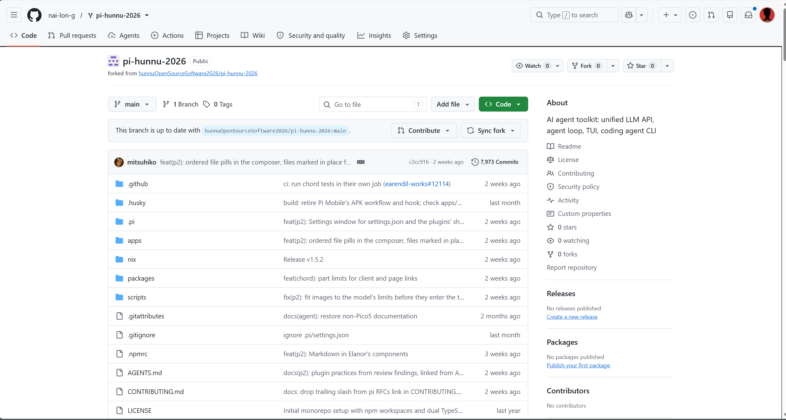
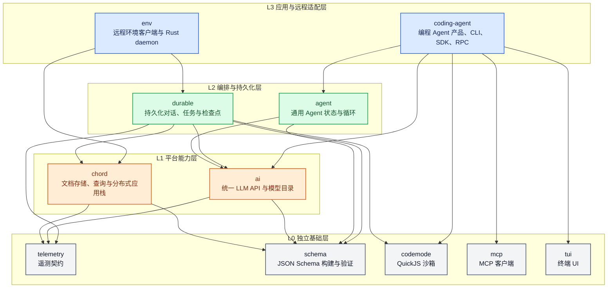

# pi-agent 模块功能、构建与内部依赖分析

## 1. 分析口径

- **源码基线**：用户本机 `D:\pi-hunnu-2026`，下表 11 个包的 `version` 均为 **1.5.2**。构建生成细节另与同版本公开源码交叉核对；公开快照为 `22fc026b872b4a7df22ffa94e8fa00b873128054`。
- **依赖口径**：以各包 `package.json` 的 `dependencies` 为主，并用 `src/` 中的实际 import 复核。表中“直接依赖”仅指内部运行依赖，不把传递依赖重复展开，也不把 `examples/`、测试或文档中的引用算成核心运行依赖。
- **构建口径**：分析各包普通 `npm run build`，不是根目录全量发布，也不把 `build:binary`、`build:daemon`、`build:native` 等额外命令混入普通 build。本文是**静态源码分析，未实际执行 build**。
- **通用 TypeScript 产物**：各包均以 `tsc -b tsconfig.build.json` 编译，`rootDir=src`、`outDir=dist`；根 `tsconfig.base.json` 开启 `declaration`、`declarationMap`、`sourceMap`，所以通常生成 ESM `.js`、`.d.ts`、`.js.map`、`.d.ts.map`。`tsc -b` 还会按 `references` 处理项目引用。
  
  小组仓库截图
   
   
   

## 2. 模块分析表

| 子文件夹 | 代码主要实现什么功能 | 本模块 build 执行什么、生成什么 | 直接依赖哪些内部模块 | 依据文件或代码位置 |
|---|---|---|---|---|
| **telemetry** | 定义与具体遥测 SDK 解耦的契约：trace/span、context propagation、attributes、counter/upDownCounter/histogram、存储查询；另提供内存实现、ANSI trace 渲染及 testing 辅助入口。 | `tsc -b`；生成 `dist/index.js`、`dist/render.js`、`dist/testing.js` 及对应声明和 source map。不生成或打包外部遥测后端。 | **无** | 功能：`README.md:3-15`，`src/index.ts:95-130`；build：`package.json:6-16,71-73`，`tsconfig.build.json:1-7`；通用输出：`tsconfig.base.json:3-21`。 |
| **schema** | 无 `eval` 的 JSON Schema（2020-12 / draft 7）构建与验证库：类型化 builders、`compile()`、纯校验 `Validator`、带默认值/类型转换的 `CoercingValidator`，以及 format 子入口。 | `tsc -b`；生成根入口 `dist/index.js` 和 `dist/formats.js` 及声明、map。 | **无** | 功能：`README.md:3-12,87-107`，`src/index.ts:1-36`；build/exports：`package.json:6-14,71-73`，`tsconfig.build.json:1-7`。 |
| **chord** | 实验性分布式应用栈与持久化文档存储：文档/内容记录、查询、CRDT、同步、jobs、watch、SQLite/PostgreSQL 适配、REPL 与隔离执行；另有 HTTP、Workers、plugins、app、web/react/tui 等子入口。 | `tsc -b`；按 `src` 目录结构生成 `dist` 下的 ESM、声明和 map，并支撑 `surfaces/*`、`http/*`、`workers/*`、`plugins/*`、`isolates/*`、`repl`、`watch` 等大量子路径导出；不是单文件 bundle。 | **schema、telemetry**（均为 runtime） | 功能：`README.md:3-42`，`src/index.ts:1-52`；build/exports：`package.json:6-64,210-211`，`tsconfig.build.json:1-8`；依赖：`package.json:65-67`，`src/telemetry.ts:8`、`src/isolate/cloudflare.ts:7`。 |
| **tui** | 终端抽象与 UI 工具包：raw input、键盘/鼠标协议、main/alt screen、差分终端渲染、native 平台能力；包含 editor、autocomplete、select、markdown 等组件。 | 普通 build 仅执行 `tsc -b`，生成 `dist/index.js`、`dist/latex.js` 及声明/map。**不编译原生 `.node`**；`build:native*` 是独立命令，发布包的 `files` 另包含 `native/**`。 | **无** | 功能：`README.md:3-16`，`src/terminal.ts:164`，`src/tui.ts`、`src/components/`；build：`package.json:6-14,73-80`，`tsconfig.build.json:1-7`；native 边界：`package.json:9-11,74-76`。 |
| **codemode** | 以 `quickjs-wasi` 执行模型生成代码：把工具 JSON Schema 转为 TypeScript 声明和命名空间调用；支持 worker、inline/同进程、Cloudflare Workers 和 remote client/server，提供存储与 host tool bridge。 | `tsc -b`；生成根入口及 `dist/worker/worker.js`、`dist/cloudflare.js`、`dist/remote.js` 等 ESM/声明/map。**不生成 QuickJS WASM**，运行时从 `quickjs-wasi` 包加载。 | **无** | 功能：`README.md:3-14,353-368`，`src/index.ts:1-66`；build/exports：`package.json:6-18,72-73`，`tsconfig.build.json:1-7`；WASM 位置：`README.md:358-368`。 |
| **mcp** | MCP 客户端封装：配置解析、stdio 与 Streamable HTTP 连接、初始化/重连、请求超时、认证头与 OAuth、输入 schema 处理、输出截断，并把 MCP tools/resources/prompts 暴露给宿主。 | `tsc -b`；生成 `dist/index.js` 及声明/map。 | **无** | 功能：`README.md:3-5,28-53,170-187`，`src/client.ts:204`；build：`package.json:6-11,70-71`，`tsconfig.build.json:1-7`。 |
| **ai** | 统一多厂商 LLM API：统一 message/model/provider 类型、流式与简单调用、provider registry、模型发现/加载/解析、内置模型目录，以及图像、OAuth、缓存等配套能力。 | 先 `generate-models --strict`：抓取上游目录，生成/更新 `src/providers/data/<provider>.json`、manifest、`src/providers/<provider>.models.ts` 和 `src/models.generated.ts`；再执行 `build:offline`：校验模型数据、`tsc -b`、清理并复制 JSON 到 `dist/providers/data`。最终含 `dist/index.js`、`dist/cli.js`、provider 实现及声明/map。 | **schema、telemetry**（均为 runtime） | 功能：`README.md:3-5,110-121,234-247`，`src/compat.ts:252-303`；build：`package.json:72-78`，`catalog/generate.ts:99,151-175,245-263`，`catalog/README.md`；依赖：`package.json:56-58`，`src/telemetry.ts:4`、`src/providers/custom/stream.ts:9`。 |
| **durable** | 面向持久化 Agent 应用的高层运行时：会话与 agent loop 调度、steer/follow-up 队列、工具/子调用、compaction、checkpoint、tasks、状态/usage 文档，以及 Chord Store 和内存存储适配。 | `tsc -b`；生成 `dist/index.js`、`dist/harness.js`、`dist/session.js`、`dist/storage/store.js`、`dist/testing.js` 及声明/map；不生成宿主二进制。 | **chord、ai、codemode、schema、telemetry**（均为 runtime） | 功能：`README.md:3-7,92-104,115-127,143-167`，`src/index.ts:20-60,144-155`；build：`package.json:6-22,84-85`，`tsconfig.build.json:1-12`；依赖：`package.json:67-73`，`src/harness/agent.ts:14-15`、`src/harness/tools.ts:15`。 |
| **env** | 远程环境模块：TypeScript 客户端连接独立 Rust `pi-env` daemon，支持 SSH/指定 daemon URL、host key 管理，以及进程、文件、Git、搜索、watch、终端等远程操作。 | 普通 build 只执行 `tsc -b`，生成 `dist/index.js` 及声明/map。**不运行 Cargo、不生成 daemon**；`build:daemon` 另行执行 `cargo build`，输出 `daemon/target/debug/pi-env`（Windows 为 `.exe`）。 | **chord、durable**（均为 runtime） | 功能：`README.md:3-10,31-54,71-83`，`src/ssh.ts:408,535`、`src/process.ts:81`；build：`package.json:6-19,72-75`，`tsconfig.build.json:1-8`；依赖：`package.json:66-68`，`src/connection.ts:11,15`。 |
| **agent** | provider-agnostic 的 Agent 核心：消息、工具、thinking 等状态，`Agent` 事件 API，以及 `agentLoop` / `agentLoopContinue` 的 prompt→stream→tool→follow-up 循环；主 agent 与 subagent 复用同一接口。 | `tsc -b`；生成 `dist/index.js` 及声明/map。 | **ai、schema**（均为 runtime） | 功能：`README.md:1-3,41-60,109-138`，`src/agent.ts:194`、`src/agent-loop.ts:47,80`；build：`package.json:6-11,68-69`，`tsconfig.build.json:1-8`；依赖：`package.json:58-60`，`src/agent-loop.ts:16`、`src/types.ts:14-15`。 |
| **coding-agent** | 面向实际编程任务的完整产品与 SDK：会话/模型/工具管理，read/bash/edit/write 等工具，交互 CLI、print/JSON、RPC，扩展、skills、主题、编辑器及多种运行模式。 | 先 `build:unbundled`：`tsc -b`、chmod、复制主题和编辑器等静态资源到 `dist`；再运行 esbuild 脚本，以 `src/cli-runtime.ts`、`src/index.ts`、`src/rpc-entry.ts` 为入口生成 `dist/bundle/`（含代码分割 chunks、lazy providers/OAuth、codemode worker、image-resize worker），并写入 `dist/bundle/cli.js` launcher。根导出仍指向未打包 `dist/index.js`，`/rpc` 与 CLI bin 使用 `dist/bundle`。**普通 build 不执行 `build:binary`。** | **agent（包名 `pi-agent-core`）、ai、codemode、mcp、tui**（均为 runtime） | 功能：`README.md:13-21,61-105`，`src/core/sdk.ts:191`、`src/core/agent-session.ts:266,409`；build：`package.json:6-25,156-161`，仓库根 `scripts/build-coding-agent-bundle.mjs:20-100,115-165`；依赖：`package.json:90-96`，`src/core/sdk.ts:42-45`、`src/main.ts:33`、`src/cli.ts:28`。 |

## 3. 内部依赖类型与排除项

1. 上表和主图共包含 **18 条直接内部运行依赖边**，全部来自各包 `dependencies`，且能在 `src/` import 中找到对应使用证据。
2. 这 11 个包的 `devDependencies` 中**没有内部模块**，因此没有需要画成开发依赖的边。
3. `chord/package.json:216-236` 将 `react`、`yjs`、`y-protocols` 标为可选 peer dependency，但它们不是本任务的内部模块，故不进入内部依赖图；本版本也没有内部 `optionalDependencies` 边。
4. `agent/examples/*.ts` 虽出现 `pi-mcp`、`pi-codemode` 的示例引用，但它们不在 `agent` 的 `src` 构建入口内，不能据此给核心 `agent` 增加运行依赖边。

## 4. 模块层级与直接依赖图

**箭头方向统一为：使用方 → 被依赖方。实线 = runtime dependency。**

## 5. 层级划分依据

采用**内部直接运行依赖 DAG 的最长路径分层**：没有内部依赖的模块为 L0；某模块若依赖其他模块，其层级为 `max(直接内部依赖层级) + 1`。因此层级是构建/复用约束的结构表达，不代表运行时调用顺序。

| 层级 | 模块 | 划分理由 |
|---|---|---|
| **L0 独立基础层** | telemetry、schema、tui、codemode、mcp | `dependencies` 中没有任何其他目标内部模块。 |
| **L1 平台能力层** | chord、ai | 二者都只直接依赖 L0 的 schema、telemetry。 |
| **L2 编排与持久化层** | durable、agent | durable 依赖 L1 的 chord、ai 以及 L0 能力；agent 依赖 L1 的 ai 和 L0 的 schema。 |
| **L3 应用与远程适配层** | env、coding-agent | env 依赖 L2 的 durable 和 L1 的 chord；coding-agent 依赖 L2 的 agent，并直接组合 L1/L0 能力。 |

### 容易误读的三点

- **durable ≠ agent 的上层包装**：本版本 `durable` 直接复用 `ai` 和 `chord` 等模块，没有声明或导入内部 `agent` 包，所以二者同处 L2，不能画 `durable → agent`。
- **coding-agent 与 env/durable 是不同分支**：`coding-agent` 没有直接依赖 `env` 或 `durable`；不能因为它们都属于 Agent 生态就补边。
- **根目录 build 顺序不等于层级依据**：根脚本中 `durable` 位于 `codemode` 之前，但各包使用 `tsc -b` 和 `references`，项目引用会参与构建。图的边仍由 manifest 与源码 import 决定，而不是由根脚本排列决定。
